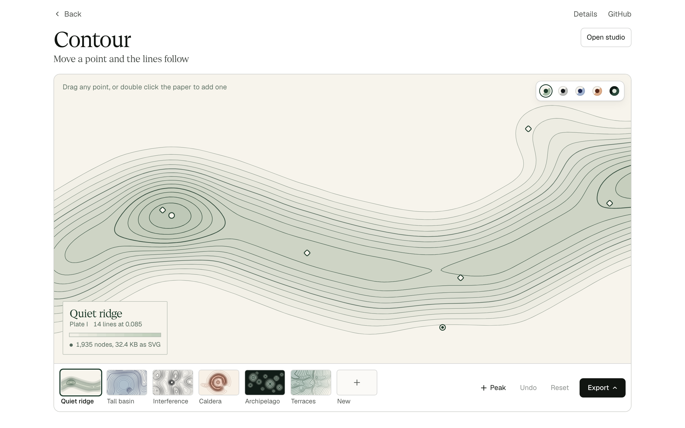
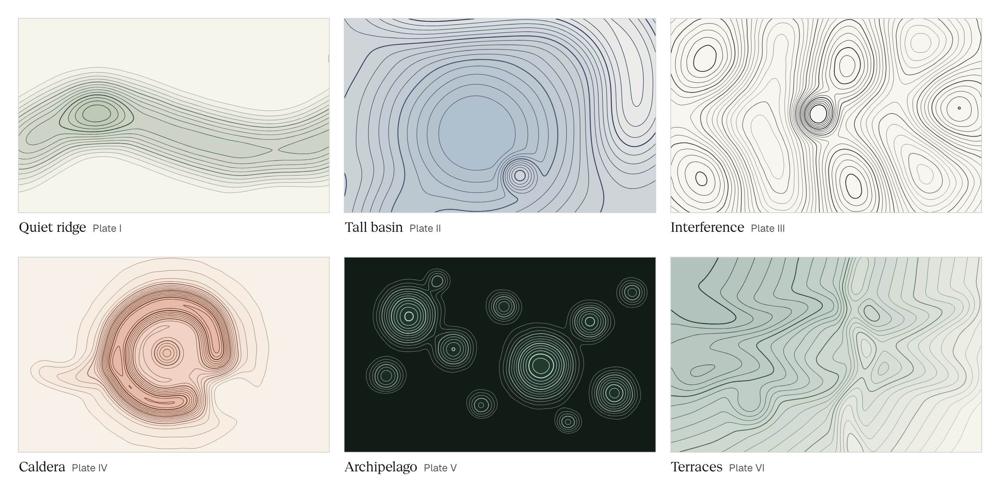
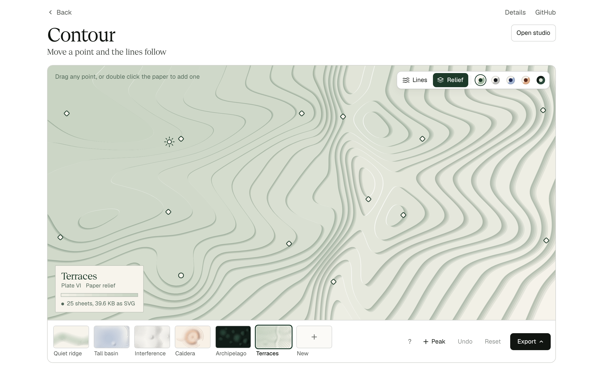
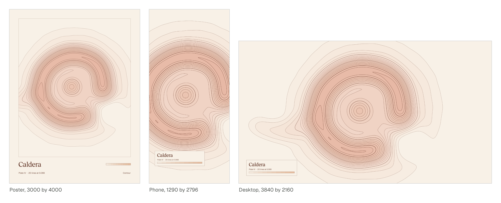
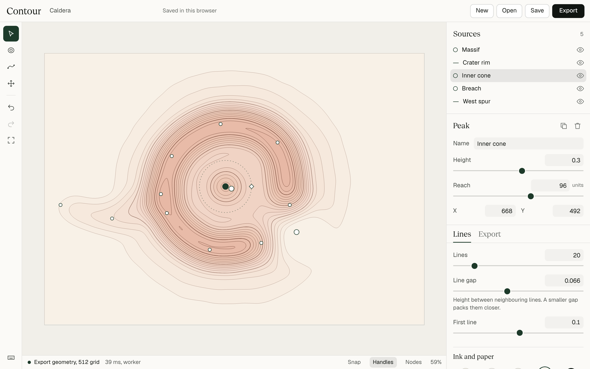

# Contour

*Shape a field, tune its lines, and export a small SVG with a measured error.*



**[Try it](https://www.qendrimbeka.com/projects/contour/)** | [Open the studio](https://www.qendrimbeka.com/projects/contour/app/) | [Walkthrough, 84 s](docs/media/walkthrough.mp4) | [Report](docs/REPORT.md)

Contour is a design tool for original line artwork. You place peaks and ridges on a sheet, drag them, and the contour lines follow. When you stop, the canvas shows the same numbers the file will contain, and the Export panel tells you the file size and how far simplifying moved the lines.

It runs in your browser, with no account, server or API key.



Each plate is a field with its own print: heavier index lines, weights that taper with height, and a flat tint laid under the lines. The tint is built from the lines themselves, so its edges always sit on them. Five inks change the print and never the geometry.

## On the page

The [page](https://www.qendrimbeka.com/projects/contour/) is the quickest way in.

1. Drag any point, or throw it and let it glide. Double click the paper to add a peak.
2. Pick a plate or an ink, or press New for a composition made from a seed.
3. Press Relief, or `L`, to see the same drawing as a stack of cut card, and drag the lamp to move the light.
4. Copy the address. It holds the plate or seed, the ink, the view, the lamp and your edits, so the link opens the same drawing.
5. Export what is on the stage: the SVG, or a desktop wallpaper, a phone wallpaper or a poster drawn from the same field at that shape.

Press `?` for the keyboard. Under the stage, the page takes the drawing apart into its five stages, shows one measured line before and after simplifying, and sets each result beside what it was measured against.



The relief is cut from the tint shapes, so every sheet of card ends exactly on a line. A lamp at a finite height throws the shadow of a raised sheet as that sheet made a little larger about the point under the lamp, which is one transform. So the relief file writes each outline once and refers to it six times: four shadow copies, a lit edge and the sheet. It holds no raster, no filter and no lines.



## Run it

The [studio](https://www.qendrimbeka.com/projects/contour/app/) runs in the browser with nothing to install. To run it yourself, you need Node 22.16 or later and pnpm 12.

```bash
git clone https://github.com/qbeka/contour-studio.git
```

```bash
cd contour-studio && pnpm install
```

```bash
pnpm dev
```

Open http://localhost:5173. It starts on a finished scene, so you can drag straight away.

## In the studio



1. Drag a handle on the sheet to move a source. Every line responds.
2. Press `P` and click to add a peak. Press `R` and click to draw a ridge, then press `Enter` to finish it.
3. Adjust Height, Reach, Line gap and Texture in the right column. Numbers can be typed.
4. Choose an ink, and set index lines, taper and tint under **Lines**.
5. Under **Lines**, choose Paper relief, or press `L`, and drag the lamp on the sheet.
6. Open **Export**, choose a line detail, and read the file size and error for your composition. If the scene has a tint, the panel says what it adds to the file. In relief it says what the relief file holds and how its size compares with the lines alone.
7. Download an SVG, a React component, a PNG or one of the ready sizes. Save the scene file to keep editing it later.

Your work saves itself in the browser. Press `?` at any time for every shortcut. `Cmd+Z` undoes.

## What you get

```xml
<svg xmlns="http://www.w3.org/2000/svg" viewBox="80 80 1440 480" width="1440" height="480"
     fill="none" stroke="#1d3a2a" stroke-width=".8" stroke-linecap="round" stroke-linejoin="round">
<title>Quiet ridge</title>
<g stroke-opacity=".28">
<path d="M1410.7 80l-16.7 4.3-25.7 6.2-14 3.2-16.8 3-22.1 3.2 ..."/>
```

There are no scripts, styles, external references or hidden data. Every contour is its own `<path>`, so it stays editable. A tint adds one group of filled paths under the lines, one for each level, and nothing else. The same export is available as a static React component:

```tsx
import { QuietRidgeArtwork } from './QuietRidgeArtwork';

<QuietRidgeArtwork className="hero-lines" aria-hidden="true" />;
```

Finished examples are in [artwork/](artwork), each with the SVG, its editable scene, a React component and a PNG. They are plain lines. The quiet ridge SVG is 17 KB, or 6 KB gzipped.

## Results

Measured on an Apple M5 Pro laptop on AC power, with other work running on it. Tables, raw data and limits are in [docs/REPORT.md](docs/REPORT.md).

<!-- results:readme-results -->
| Result | Measured | Compared with | Workload |
|---|---|---|---|
| Time to refined geometry | 12 to 20 ms in Chromium | Target of 500 ms | 512 cells on the long side, 16 levels, three scenes, 5 runs |
| Input to draft, 95th percentile | 17 ms with the worker | Target of 33 ms. The main thread is faster, at 10 ms | 150 step open loop drag, 5 runs |
| Largest frame gap, heavy scene | 25 ms with the worker | 204 ms blocking, 201 ms time sliced | 1024 grid, 64 levels, same drag, 5 runs |
| File size, same composition | 83 KB to 15 KB, or 19 KB to 5.4 KB gzipped | The same scene with nothing removed | Quiet ridge, Balanced |
| Distance moved by export | 0.19 units sampled, 0.22 proved at most | Extracted lines | Same file, sampled every 0.25 units |
| Grid error, worst place | 0.79 units | The same scene at a 2048 grid | Same scene. It sits at a near-flat saddle. Export bounds do not include it |
| Topology | 0 crossings, 0 lost paths | Extracted lines | 9 rows of the size table, plus 420 random scenes |
| Output repeatability | Identical bytes | Chromium, Firefox, WebKit, Node | One workflow's scene |
| Renderers | Within 1 px | Chromium, Firefox, WebKit, resvg | Three scenes. Resolves whole pixels. A control moved by 4 units reads 4 px or more |
<!-- /results -->

Every row was measured on plain lines, before tint and relief existed. Tint changes no line, and it roughly doubles the bytes of a file before compression, because each pass repeats its line as a shape. The report has the numbers for each plate.

These timings come from one fast machine, and nobody outside this project has used the tool yet. Path editing was checked in paper.js, not in a desktop vector editor. The worker does not make drafts faster. It keeps the page from freezing on heavy scenes.

## How it works

```
scene file
   |  sample F(p) at grid corners       field.ts
   |  marching squares, by grid edge    contour.ts
   |  join into ordered paths           contour.ts
   |  clip to the frame                 clip.ts
   |  simplify, round, check topology   simplify.ts, topology.ts
   v
output geometry  ->  canvas preview and SVG print the same numbers
```

- **The field** is a sum of smooth bounded sources plus bounded noise. It uses only operations IEEE 754 fixes exactly, so the same scene gives the same bits on any engine.
- **Crossings are identified by grid edge**, never by position. Neighbouring cells share an integer, so cracks cannot occur and no joining tolerance exists.
- **Ambiguous cells** use the asymptotic decider. Ties have one written rule.
- **Simplification** has a proved bound. Paths that would break a topology rule are retried at finer settings, per path, and the export reports it.
- **Tint** never samples the field. Every path runs with the higher ground on its left, so a path that leaves the frame is closed along the frame's edge until the next one comes in.
- **Relief** is those tint shapes stacked as card. Each shadow is its sheet scaled about the lamp, so the canvas and the file draw the same picture from the same outlines, and the plain export is not touched.
- **Drafts and finals** run in a worker, with a main thread fallback. A newer edit cancels a running final, and results commit in scene order, so an old render cannot overwrite a newer drag.

The full model and proofs are in [docs/GEOMETRY.md](docs/GEOMETRY.md).

## Tests and benchmarks

| Command | What it does |
|---|---|
| `pnpm dev` | Runs the app on port 5173 |
| `pnpm build` | Type checks and builds the static app into `dist` |
| `pnpm check` | Type checks |
| `pnpm test` | Unit, property and regression tests, with seeded negative controls |
| `pnpm build:site` | Builds the project page and the studio into `dist-site` |
| `pnpm test:e2e` | Browser tests of the built site. The core workflows run in Chromium, Firefox and WebKit |
| `pnpm bench:smoke` | One short pass, to check the harness |
| `pnpm bench` | The frozen plan in [docs/BENCH_PLAN.md](docs/BENCH_PLAN.md). Takes a few minutes |

Further checks are in `scripts/`: a mutation run, renderer comparison, a clean consumer build and a clean checkout run. [docs/REPORT.md](docs/REPORT.md) lists the commands.

Browser tests need Playwright's browsers once:

```bash
pnpm exec playwright install chromium firefox webkit
```

`pnpm bench` reads hardware details with macOS tools (`sw_vers`, `sysctl`, `pmset`), so it runs on macOS. The renderer comparison needs `xmllint`.

## Documents

- [docs/GEOMETRY.md](docs/GEOMETRY.md): the field, extraction, error bounds and topology rules
- [docs/REPORT.md](docs/REPORT.md): measurements, failures and limits
- [docs/BENCH_PLAN.md](docs/BENCH_PLAN.md): the benchmark plan and its amendments
- [docs/RESEARCH.md](docs/RESEARCH.md): the papers and tools behind the methods

## License

MIT for the code. See [LICENSE](LICENSE). The fonts and other third party items keep their own licenses, listed in [THIRD_PARTY_NOTICES.md](THIRD_PARTY_NOTICES.md).
