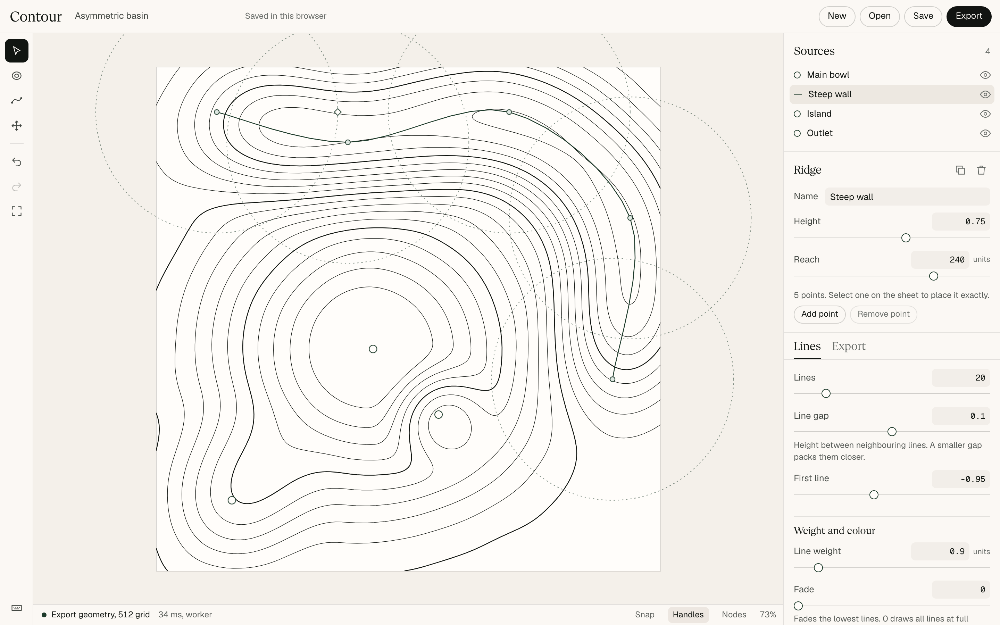

# Contour

*Shape a field, tune its lines, and export a small SVG with a measured error.*



[Signature interaction, 22 s](docs/media/signature.mp4) | [Captioned walkthrough, 68 s](docs/media/walkthrough.mp4) | [Report](docs/REPORT.md)

No hosted demo yet. Run it locally with the three commands below. It needs no account, no server and no API key.

Contour is a local design tool for original line artwork. You place peaks and ridges on a sheet, drag them, and the contour lines respond. Once the preview settles, it draws the same numbers the file contains. The Export panel tells you the file size and how far simplifying moved the lines, for your composition.

Shader tools make good pictures quickly, but the picture is an effect. You cannot edit it as vectors, or say how far a traced copy differs from what you saw. Contour's contribution is controlled authorship and a file you can trust.

## Results

Measured on an Apple M5 Pro laptop on AC power, with other work running on it. Full tables, raw data and limits are in [docs/REPORT.md](docs/REPORT.md).

| Result | Measured | Compared with | Workload |
|---|---|---|---|
| Time to refined geometry | 14 to 25 ms in Node, 15 ms in Chromium | Target of 500 ms | 512 by 512, 16 levels, three scenes, 7 runs in Node and 5 in Chromium |
| Time from input to draft | 17 ms at the 95th percentile | Target of 33 ms | 150 step drag, 5 runs. It is not faster than the main thread, at 9 ms |
| Largest frame gap, heavy scene | 40 ms with the worker | 157 ms blocking, 65 ms time sliced | 1024 grid, 64 levels, same drag, 5 runs |
| File size, same composition | 83 KB to 15 KB, or 19 KB to 5.4 KB gzipped | The same scene with nothing removed | Quiet ridge, Balanced |
| Distance from exported to extracted lines | 0.19 units measured, 0.22 allowed | Proved bound | Same file, sampled every 0.25 units |
| Topology | 0 crossings, 0 lost paths | Extracted lines | 9 rows of the size table, plus 420 random scenes |
| Output repeatability | Identical bytes | Chromium, Firefox, WebKit, Node | One workflow's scene |
| Renderers | Within 1 px | Chromium, Firefox, WebKit, resvg | Three scenes. Resolves whole pixels. A control moved by 4 units reads 4 px or more |

Three things this does not show. All timings come from one fast machine. No outside person has used the tool. No desktop vector editor has opened the files yet: path editing was checked in paper.js only.

The worker result is smaller than I first measured. An early baseline made it look 18 times faster, because of a flaw in the baseline. See [the report](docs/REPORT.md#performance).

## Run it

You need Node 22.16 or later and pnpm 12. The app itself needs nothing else.

```bash
pnpm install
```

```bash
pnpm dev
```

Open http://localhost:5173. It starts on a real scene. Press `?` for shortcuts.

## A short example

This is the start of the quiet ridge starter, exported as it opens:

```xml
<svg xmlns="http://www.w3.org/2000/svg" viewBox="80 80 1440 480" width="1440" height="480"
     fill="none" stroke="#1d3a2a" stroke-width=".8" stroke-linecap="round" stroke-linejoin="round">
<title>Quiet ridge</title>
<g stroke-opacity=".28">
<path d="M1410.7 80l-16.7 4.3-25.7 6.2-14 3.2-16.8 3-22.1 3.2 ..."/>
```

There are no scripts, styles, external references or hidden data. Every contour is its own `<path>`, so it stays editable. The same export is available as a static React component:

```tsx
import { QuietRidgeArtwork } from './QuietRidgeArtwork';

<QuietRidgeArtwork className="hero-lines" aria-hidden="true" />;
```

Finished examples are in [artwork/](artwork). Each has the SVG, its editable scene, a React component and a PNG fallback. The quiet ridge SVG is 17 KB, or 6 KB gzipped.

## How it works

```
scene file
   |  sample F(p) at grid corners       field.ts
   |  marching squares, by grid edge    contour.ts
   |  join into ordered paths           contour.ts
   |  clip to the frame                 clip.ts
   |  simplify, round, check topology   simplify.ts, topology.ts
   v
output geometry  ->  canvas preview and SVG print the same numbers
```

- **The field** is a sum of smooth bounded sources plus bounded noise. It uses only operations IEEE 754 fixes exactly, so the same scene gives the same bits on any engine.
- **Crossings are identified by grid edge**, never by position. Neighbouring cells share an integer, so cracks cannot occur and no joining tolerance exists.
- **Ambiguous cells** use the asymptotic decider. Ties have one written rule.
- **Simplification** has a proved bound. Paths that would break a topology rule are retried at finer settings, per path, and the export reports it.
- **Drafts and finals** run in a worker, with a main thread fallback. A newer edit cancels a running final, and results commit in scene order, so an old render cannot overwrite a newer drag.

The full model and proofs are in [docs/GEOMETRY.md](docs/GEOMETRY.md).

## Tests and benchmarks

| Command | What it does |
|---|---|
| `pnpm dev` | Runs the app on port 5173 |
| `pnpm build` | Type checks and builds the static app into `dist` |
| `pnpm check` | Type checks |
| `pnpm test` | Unit, property and regression tests, with seeded negative controls |
| `pnpm test:e2e` | Browser tests. The core workflow runs in Chromium, Firefox and WebKit |
| `pnpm bench:smoke` | One short pass, to check the harness |
| `pnpm bench` | The frozen plan in [docs/BENCH_PLAN.md](docs/BENCH_PLAN.md). Takes a few minutes |

Further checks are in `scripts/`: a mutation run, renderer comparison, a clean consumer build and a clean checkout run. [docs/REPORT.md](docs/REPORT.md) lists the commands.

Browser tests need Playwright's browsers once:

```bash
pnpm exec playwright install chromium firefox webkit
```

`pnpm bench` reads hardware details with macOS tools (`sw_vers`, `sysctl`, `pmset`), so it runs on macOS. The renderer comparison needs `xmllint`.

## Documents

- [docs/GEOMETRY.md](docs/GEOMETRY.md): the field, extraction, error bounds and topology rules
- [docs/DESIGN.md](docs/DESIGN.md): the user, the workflow, and the design I rejected
- [docs/REPORT.md](docs/REPORT.md): measurements, failures and limits
- [docs/RESEARCH.md](docs/RESEARCH.md): sources, and what changed after measurement
- [docs/USABILITY.md](docs/USABILITY.md): a task script and a heuristic review. No outside participants yet
- [docs/CHECKPOINT.md](docs/CHECKPOINT.md): current state

## License

MIT for the code. See [LICENSE](LICENSE). The fonts and other third party items keep their own licenses, listed in [THIRD_PARTY_NOTICES.md](THIRD_PARTY_NOTICES.md).
